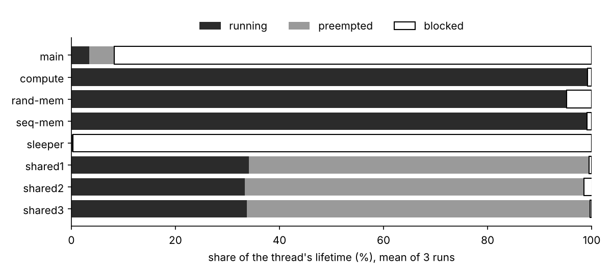

# Experiment 01: laptop (MacBook Air, Linux in Docker), no hardware counters

The first test of the harness, run before the target boards were available.

## What is in this folder

| File | What it is |
|---|---|
| `README.md` | this description: purpose, setup, how to repeat it, results, analysis |
| `raw/output.txt` | the complete, unedited output of the three runs |
| `summary.csv` | per-thread results: mean, minimum and maximum over the three runs |
| `thread_time_split.png` | figure: how each thread spent its lifetime |

## Why this experiment

The full method needs a board that exposes its hardware performance counters (Raspberry
Pi 5, Jetson Orin Nano). Before those were set up, this test checks everything that does
**not** need counters:

- finding every thread of an **unmodified** program by itself (run mode);
- measuring each thread's running time, and splitting the rest into **preempted** and **blocked**;
- the WAITING labels and sub-categories;
- the memory tiers, measured from timing alone;
- that the harness says clearly what it cannot measure when counters are missing.

## Setup

| Item | Value |
|---|---|
| Host | Apple-silicon MacBook Air, macOS |
| Linux environment | Docker Desktop 29.9 (a Linux virtual machine), image `gcc:14` |
| Cores given to Linux | 8 |
| Hardware counters | none: macOS keeps them private, and Docker's virtual machine does not pass them through |
| Scheduler statistics | available (`/proc/<pid>/task/<tid>/schedstat`), so waiting is split into preempted and blocked |
| Program profiled | `pmu_harness/workload.c`, unmodified (no harness calls), 8 threads |
| Harness | `pmu_harness/pmu.c` + `pmurun.c`, run mode |
| Runs | 3 |

Why Docker: macOS does not let ordinary programs read the CPU's counters, and run mode
needs Linux to follow a program's threads. Docker Desktop runs Linux in a lightweight
virtual machine on the Mac.

## How to repeat it

1. Install Docker Desktop for Mac, open it, and wait for **Engine running**.
   In Settings → VM resources, give it at least 4 CPUs.
2. In Terminal, from the `harness/` folder:

```bash
bash reproducibility/run_mac_docker.sh macbook-air 3
```

This records the Mac's details, builds the harness and the validation program inside Linux,
profiles the program 3 times, and saves everything in `experiments/<date>-macbook-air/`.

The command used for the results below (equivalent, run by hand from `pmu_harness/`):

```bash
docker run --rm --privileged -v "$PWD":/h -w /h gcc:14 bash -c \
  "gcc -O2 pmu.c pmurun.c -o pmurun -pthread && gcc -O2 workload.c -o workload -pthread && \
   nproc && for i in 1 2 3; do ./pmurun ./workload; done" | tee mac_docker.txt
```

`--privileged` allows the harness to follow the program's threads (`ptrace`) and to try to
open counters.

## The program that was profiled

`workload.c` is an ordinary multi-threaded C program; it contains no harness code. Each thread
has one known behaviour:

| Thread | What it does | Expected here (no counters) |
|---|---|---|
| main | starts the threads and waits for them | WAITING / blocked |
| `compute` | floating-point arithmetic in registers | RUNNING (own core) |
| `rand-mem` | reads a 64 MB buffer at random positions | RUNNING (own core) |
| `seq-mem` | reads the same buffer in order, 8 times | RUNNING (own core) |
| `sleeper` | sleeps 2 ms then does a little work, 50 times | WAITING / blocked |
| `shared1..3` | the `compute` work, all three pinned to one core | WAITING / preempted, about 2/3 |

## Results

### Board profile

All three runs printed `counters: none (only waiting vs running can be shown)`.

Memory tiers found by the sweep (time per dependent access, mean of 3 runs):

| Tier | Working sets | ns per access | Consistent with |
|---|---|---|---|
| T0 | 4–64 KB | 1.9 | private L1 data cache |
| T1 | 256 KB–4 MB | 6.2–7.7 | shared L2 cache |
| T2 | 16 MB | 26.4 | beyond L2: system-level cache and RAM |
| T3 | 64 MB | 94.8 | RAM |

### Threads (mean of 3 runs, range in brackets)

| Thread | Lifetime (ms) | Running % | Preempted % | Blocked % | Forced switches | Voluntary switches | Label (all 3 runs) |
|---|---|---|---|---|---|---|---|
| main | 165.0 [162.0–170.9] | 3.4 [3.2–3.8] | 4.8 [2.5–6.4] | 91.7 [90.3–93.7] | 3–5 | 18–19 | WAITING / blocked |
| `compute` | 55.7 [54.6–56.5] | 99.2 [98.0–99.9] | 0.0 | 0.8 [0.1–2.0] | 0 | 2 | RUNNING |
| `rand-mem` | 35.7 [33.2–39.5] | 95.2 [88.5–99.6] | 0.0 | 4.8 [0.4–11.5] | 0 | 2 | RUNNING |
| `seq-mem` | 57.6 [57.1–58.2] | 99.1 [98.4–99.7] | 0.0 | 0.9 [0.3–1.6] | 0 | 2 | RUNNING |
| `sleeper` | 120.5 [120.0–121.2] | 0.3 | 0.0 | 99.7 | 0 | 52 | WAITING / blocked |
| `shared1` | 153.2 [148.5–156.8] | 34.2 [33.4–35.2] | 65.3 [64.8–66.1] | 0.5 [0.0–1.5] | 18–27 | 2 | WAITING / preempted |
| `shared2` | 156.3 [155.8–156.7] | 33.4 [33.3–33.5] | 65.1 [64.5–66.0] | 1.6 [0.7–2.1] | 18 | 2 | WAITING / preempted |
| `shared3` | 154.0 [152.9–155.6] | 33.8 [33.4–34.0] | 65.9 [65.3–66.5] | 0.3 [0.0–0.8] | 18–19 | 2 | WAITING / preempted |



## Analysis

**Finding threads.** All 8 threads were found in every run, from their first instruction to
their exit, without the program containing any harness code and without knowing the
number of threads in advance.

**Preemption.** The three threads pinned to one core each ran about one third of the time
(33.4–34.2%) and were preempted about two thirds (65.1–65.9%), with 18–27 forced switches
each. The numbers are consistent: each shared thread ran for about 0.34 × 154 ≈ 52 ms, close
to the 55.7 ms the identical `compute` thread needed on its own core, and its lifetime
(≈154 ms) is about three times that. The extra time is correctly explained as waiting for the
core, not as slower code.

**Blocking.** The sleeper was blocked 99.7% of its lifetime, with 52 voluntary switches (50
sleeps, plus thread start and end). It asked for 50 × 2 ms = 100 ms of sleep but was blocked
for 120.1 ms: each "2 ms" sleep really lasted about 2.4 ms. The harness thereby measures a
property of the platform (the cost of waking a sleeping thread), not of the program. The main
thread, which only waits for the others, was blocked 90–94%, and briefly preempted while
seven workers competed for the cores.

**Independent threads.** `compute`, `rand-mem` and `seq-mem` each had a core and ran 95–99%
of their lifetime, with no preemption. Without counters their running time cannot be split
into COMPUTE, MEMORY and STALLED, so the harness labelled them RUNNING, as designed. It
printed `-` for every quantity it could not measure instead of guessing.

**Memory tiers.** Four tiers were found from timing alone, consistent with a private L1, a
shared L2, a system-level cache and RAM: tier detection works even without counters.

**Repeatability.** Results stayed within a few percent across runs, except `rand-mem` in run
3, which was blocked for 11.5% of its lifetime (0.4–2.6% in the other runs). The cause was
not identified; the most likely explanation is the Mac briefly pausing the Linux virtual
machine. Results should always be reported over several runs.

**Conclusion.** Confirmed: thread discovery, running / preempted / blocked times, the WAITING
labels, timing-only memory tiers, and explicit handling of missing counters. Not testable
here: the instruction mix, the COMPUTE / MEMORY / STALLED / KERNEL categories and the
visible and hidden memory delays. These need a board with counters (next: Raspberry Pi 5).
